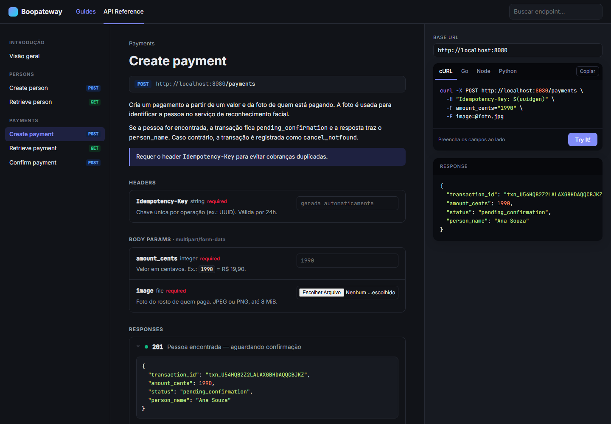
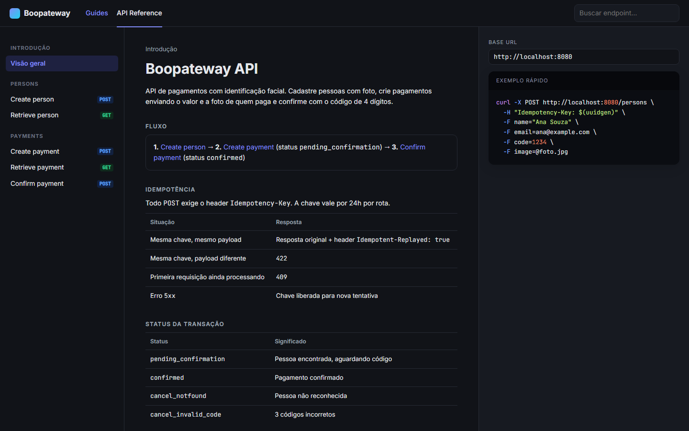
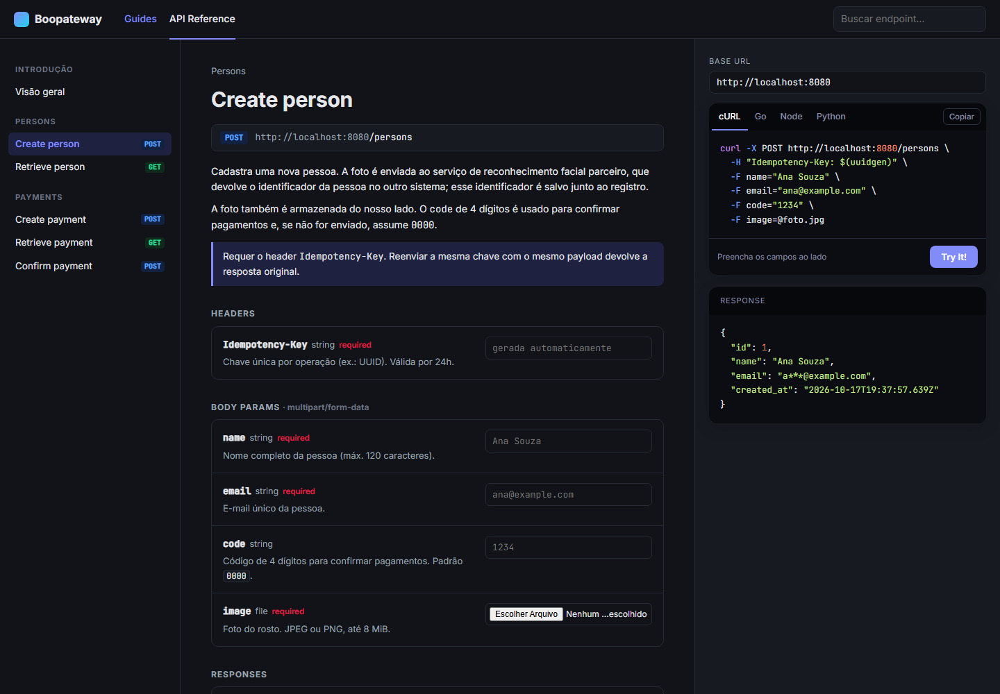
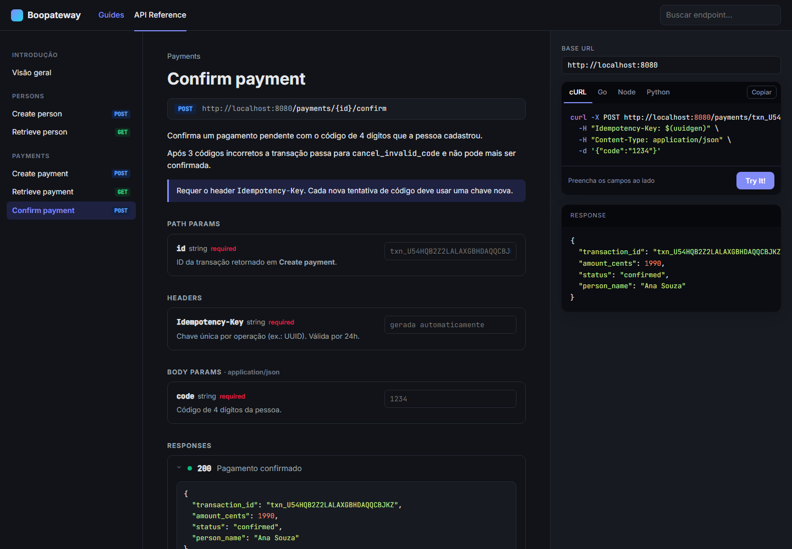
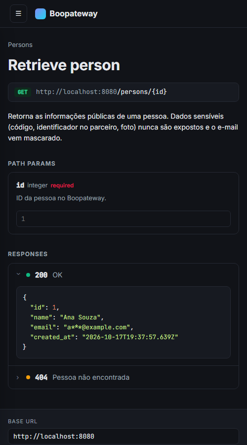
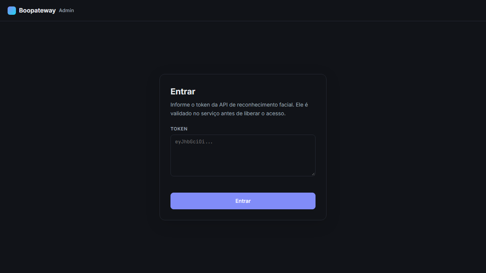

# boopateway

Gateway de pagamento de exemplo com identificação facial (Go 1.26 + Gin + SQLite).

A pessoa se cadastra com uma foto, paga enviando **valor + foto** e confirma o pagamento com
um **código de 4 dígitos**. Toda operação de escrita é **idempotente**.



> Resumo completo das APIs (bodies, responses, erros e curls) para outra IA ou dev implementar
> um cliente: [docs/API_SUMMARY.md](docs/API_SUMMARY.md)

## Sumário

- [Documentação da API](#documentação-da-api)
- [Rodando](#rodando)
- [Portal administrativo](#portal-administrativo)
- [Fluxo de pagamento](#fluxo-de-pagamento)
- [Idempotência](#idempotência)
- [Endpoints](#endpoints)
- [Arquitetura](#arquitetura-clean-architecture)

## Documentação da API

Com o servidor rodando, acesse **http://localhost:8080/docs**. A página vem embutida no
binário (`go:embed`), não precisa de nenhum servidor extra.

### Visão geral

Fluxo de pagamento, regras de idempotência, status das transações e atalhos para cada endpoint.



### Página de cada endpoint

Cada endpoint tem três colunas:

1. **Menu lateral** com os endpoints agrupados (Persons / Payments) e etiqueta `GET`/`POST`.
2. **Descrição e parâmetros**: path params, headers e body params, com tipo, indicação de
   obrigatório e um campo para preencher o valor. Abaixo, as respostas possíveis por status
   code, com exemplo de JSON.
3. **Exemplos de código** em cURL, Go, Node e Python, gerados a partir dos valores digitados,
   com botão de copiar e o **Try It!**.



### Try It!

O botão **Try It!** envia a requisição real para a API e mostra o status e o JSON de resposta
no painel *Response*. A `Idempotency-Key` é gerada automaticamente a cada envio (ou use uma
fixa para ver o replay, indicado como `· replay` no status). Os campos de imagem aceitam upload
direto do arquivo. A **Base URL** pode ser alterada no topo do painel para apontar para outro
ambiente.



### Telas pequenas

Em telas estreitas o menu vira um botão ☰ e os exemplos de código descem para baixo do conteúdo.



### Adicionando um endpoint à documentação

A página é um único arquivo:
[`internal/framework/httpserver/docs/index.html`](internal/framework/httpserver/docs/index.html).
Para documentar uma rota nova, adicione um item na lista `ENDPOINTS` no começo do script:

```js
{
  id: "get-payment", group: "Payments", title: "Retrieve payment", method: "GET", path: "/payments/{id}",
  desc: ["Consulta o status atual de uma transação."],
  pathParams: [{ name: "id", type: "string", required: true, desc: "ID da transação.", example: "txn_..." }],
  responses: [{ code: 200, desc: "OK", body: { transaction_id: "txn_...", status: "confirmed" } }],
}
```

Menu, tabelas, exemplos de código e o Try It! são montados a partir desses dados.

## Rodando

```bash
export BOOP_TOKEN=seu_token            # obrigatório (Authorization do parceiro)
export BOOP_BASE_URL=http://localhost:8000
go run ./cmd/fakeboop &                # parceiro falso para dev (opcional)
go run ./cmd/api                       # sobe em :8080
```

### Docker

A API sobe na porta **31800**, o portal administrativo na **31801**, e fala com o booprecognition rodando no host na porta **31900**
(`host.docker.internal:31900`). Banco e fotos ficam no volume `boopateway-data`.

```bash
cp .env.example .env      # preencha BOOP_TOKEN
docker compose up -d --build
```

Docs: http://localhost:31800/docs

| Variável | Padrão | Descrição |
|---|---|---|
| `BOOP_TOKEN` | — | Token Bearer da API de reconhecimento facial (**obrigatório**) |
| `BOOP_BASE_URL` | `http://localhost:8000` | URL da API de reconhecimento facial |
| `BOOP_SEARCH_PATH` | `/identify` | Rota usada para buscar a pessoa pela foto (não cadastra rostos desconhecidos; `null` = não encontrada) |
| `ADDR` | `:8080` | Endereço do servidor HTTP |
| `DB_PATH` | `data/boopateway.db` | Arquivo SQLite |
| `IMAGE_DIR` | `data/images` | Pasta onde as fotos das pessoas são salvas |

O `cmd/fakeboop` simula o parceiro: a mesma foto (bytes idênticos) sempre devolve o mesmo
`identification`.

## Portal administrativo

Portal web em **http://localhost:31801** para **listar e excluir pessoas**. Roda em um container
separado (`boopateway-portal`) e repassa as chamadas `/api/*` para a API.



- **Login**: informe o token da API booprecognition. Ele é validado no booprecognition
  (`POST /identify` sem imagem: 401 = inválido) antes de liberar qualquer dado. O token fica só
  na aba (`sessionStorage`) e some ao clicar em **Sair** ou fechar a aba.
- **Lista**: foto, nome, e-mail, ID, ID no parceiro e data de cadastro, com paginação e filtro.
- **Histórico**: botão em cada pessoa que abre as transações dela (valor, status, tentativas de código e data), com paginação.
- **Aba Transações**: busca transações de todas as pessoas filtrando por nome, e-mail, valor (R$) e status, com paginação.
- **Excluir**: habilitado somente se o token tiver o scope `persons:delete`; caso contrário o
  portal fica em modo somente leitura. A exclusão remove a pessoa no booprecognition, na base e
  apaga a foto. O histórico de transações é mantido e os pagamentos pendentes dela viram
  `cancel_person_deleted`.

Endpoints usados pelo portal: `GET /admin/session`, `GET /admin/persons`,
`GET /admin/persons/{id}/image`, `GET /admin/persons/{id}/transactions`, `GET /admin/transactions` e `DELETE /admin/persons/{id}`. Detalhes em
[docs/API_SUMMARY.md](docs/API_SUMMARY.md#37-endpoints-administrativos-admin).

## Fluxo de pagamento

```
POST /persons  ──►  POST /payments  ──►  POST /payments/{id}/confirm
 (foto + code)       (valor + foto)          (code de 4 dígitos)
                          │
                ┌─────────┴──────────┐
        pessoa encontrada     não encontrada
     pending_confirmation     cancel_notfound
                │
       ┌────────┴─────────┐
   code correto     3 codes errados
    confirmed     cancel_invalid_code

(pessoa excluída no portal com pagamento pendente → cancel_person_deleted)
```

## Idempotência

Todo `POST` exige o header `Idempotency-Key`. A chave vale por 24h por rota.

| Situação | Resposta |
|---|---|
| Mesma chave, mesmo payload | Resposta original + header `Idempotent-Replayed: true` |
| Mesma chave, payload diferente | `422` |
| Primeira requisição ainda processando | `409` |
| Erro `5xx` | Chave liberada para nova tentativa |

Em `multipart/form-data` o hash é calculado sobre os campos (nome + conteúdo), não sobre os
bytes brutos, já que o boundary muda a cada envio.

## Endpoints

| Método | Rota | Corpo |
|---|---|---|
| POST | `/persons` | multipart: `name`, `email`, `image`, `code` (4 dígitos, padrão `0000`) |
| GET | `/persons/{id}` | — (sem dados sensíveis, e-mail mascarado) |
| POST | `/payments` | multipart: `amount_cents`, `image` |
| GET | `/payments/{id}` | — |
| POST | `/payments/{id}/confirm` | JSON `{"code":"1234"}` |
| GET | `/docs` | Documentação interativa |
| GET | `/healthz` | Health check |
| GET | `/admin/session` | Valida o token admin (Bearer = token booprecognition) |
| GET | `/admin/persons` | Lista pessoas (`page`, `limit`) |
| GET | `/admin/persons/{id}/image` | Foto da pessoa |
| GET | `/admin/persons/{id}/transactions` | Histórico de transações da pessoa (`page`, `limit`) |
| GET | `/admin/transactions` | Busca transações (`name`, `email`, `amount_cents`, `status`, `page`, `limit`) |
| DELETE | `/admin/persons/{id}` | Exclui a pessoa (scope `persons:delete`) |

```bash
curl -X POST localhost:8080/persons -H "Idempotency-Key: $(uuidgen)" \
  -F name=Ana -F email=ana@x.com -F code=1234 -F image=@foto.jpg
curl -X POST localhost:8080/payments -H "Idempotency-Key: $(uuidgen)" \
  -F amount_cents=1990 -F image=@foto.jpg
curl -X POST localhost:8080/payments/txn_XXX/confirm -H "Idempotency-Key: $(uuidgen)" \
  -d '{"code":"1234"}'
```

## Arquitetura (Clean Architecture)

```
cmd/api/main.go                      # composição (injeção de dependências)
cmd/fakeboop/main.go                 # parceiro falso para desenvolvimento
cmd/portal/main.go                   # portal administrativo (porta 31801)
internal/domain/
  entity/                            # Person, Transaction, Image, erros de domínio
  repository/                        # interfaces de persistência
  gateway/                           # interfaces de serviços externos (reconhecimento, storage, hash)
internal/usecase/                    # regras de negócio
  create_person_usecase.go  get_person_usecase.go
  create_payment_usecase.go get_payment_usecase.go confirm_payment_usecase.go
internal/framework/
  booprecognition/                   # TODA integração com a API Boop
    client.go dto.go register_person.go search_person.go face_recognition_gateway.go
  database/sqlite/                   # repositórios SQLite
  storage/local_image_storage.go     # fotos em disco
  security/bcrypt_code_hasher.go     # hash do código de 4 dígitos
  httpserver/                        # Gin: router, handlers, middleware de idempotência
    docs/                            # página de documentação (index.html embutido)
  portal/                            # portal web (index.html embutido + proxy /api)
  config/
docs/images/                         # imagens deste README
```

As dependências apontam para dentro: `framework` → `usecase` → `domain`. Os use cases só
conhecem interfaces; trocar o Boop por outro provedor é criar outro pacote em `framework/`
que implemente `gateway.FaceRecognitionGateway`.
